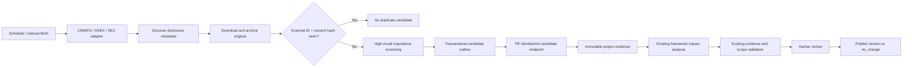

# Financial Information Service

Independent collection service for official CNINFO, HKEXnews and SEC EDGAR disclosures. It discovers documents, archives immutable originals, deduplicates by `provider + externalId + contentHash`, assigns a conservative importance label, and delivers review-required framework update candidates to PE-Workbench. Upstream requests are host-throttled and retry transient failures while respecting `Retry-After`; unsupported binary responses are rejected instead of becoming evidence. SEC searches include matching historical submission shards in addition to the recent filing window.

The service never publishes an investment framework. PE-Workbench remains responsible for evidence registration, impact analysis, framework validation, human review and publication.

## Flow



## Configuration

```sh
export FINANCIAL_INFORMATION_SERVICE_TOKEN='service-api-secret'
export FINANCIAL_INFORMATION_SERVICE_URL='http://127.0.0.1:30241'
export FINANCIAL_INFORMATION_DATA_DIR='/absolute/path/to/information-data'
export SEC_EDGAR_USER_AGENT='PE Workbench research@example.com'

export PE_WORKBENCH_URL='http://127.0.0.1:30141'
export PE_WORKBENCH_INGEST_TOKEN='candidate-delivery-secret'
```

`PE_WORKBENCH_INGEST_TOKEN` must also be configured in the PE-Workbench web process. `FINANCIAL_INFORMATION_SERVICE_URL` and `FINANCIAL_INFORMATION_SERVICE_TOKEN` must be configured in PE-Workbench if `pe_trusted_source(operation=fetch_official)` should issue manual one-shot requests.

Start the service:

```sh
npm run information:service
```

Create a subscription:

```sh
curl -X POST http://127.0.0.1:30241/v1/subscriptions \
  -H "Authorization: Bearer $FINANCIAL_INFORMATION_SERVICE_TOKEN" \
  -H 'Content-Type: application/json' \
  -d '{"datasetId":"dataset_id","provider":"cninfo","securityCode":"600519","intervalMinutes":30}'
```

Provider identifiers:

- CNINFO: six-digit A-share code.
- HKEX: one-to-five-digit stock code; it is normalized to five digits.
- SEC EDGAR: one-to-ten-digit CIK. `query` may be a comma-separated form allow-list such as `10-K,10-Q,8-K`.

The first run looks back 30 days by default. Later runs overlap the previous successful cursor by two days and rely on immutable content hashes for safe deduplication.
